<p align="center">
  
</p>

<h1 align="center">hopshift</h1>

<p align="center">
  Migrate infrastructure from any source to any target through one canonical model.<br/>
  Discovery in, validated and compliant Terraform out, reviewed by people, deployed with approval.
</p>

<p align="center">
  <a href="https://github.com/blacksoxx/hopshift/actions/workflows/ci.yml"></a>
  <a href="https://github.com/blacksoxx/hopshift/actions/workflows/codeql.yml"></a>
  <a href="https://scorecard.dev/viewer/?uri=github.com/blacksoxx/hopshift"></a>
  <a href="https://github.com/blacksoxx/hopshift/tree/python-coverage-comment-action-data"></a>
  <a href="https://github.com/blacksoxx/hopshift/releases"></a>
  <a href="https://github.com/blacksoxx/hopshift/pkgs/container/hopshift"></a>
  <a href="LICENSE"></a>
  
  
  
</p>

<p align="center">
  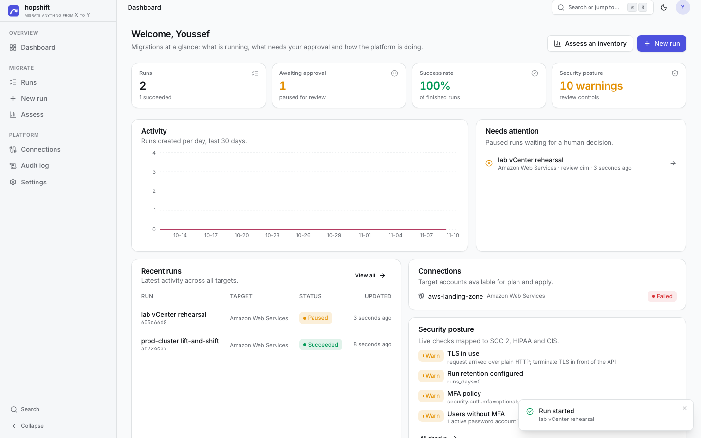
</p>

---

Lift-and-shift migrations fail in the details: the VM nobody noticed was encrypted, the
security group someone opened to the world, the disk that was never encrypted, the change that
was applied without review. hopshift makes the boring path the default, whatever you migrate
from and wherever you migrate to.

- **One canonical model.** Every source is translated into the Canonical Infrastructure Model
  (CIM); every target is rendered from it. Sources and targets are plugins and never see each
  other. Today: VMware vSphere in; AWS, Azure, GCP and OpenStack out.
- **Deterministic core.** A discovery file becomes a CIM, then Terraform rendered from code.
  Same input, same output, every time. Diffable, reviewable, testable.
- **Validated before it exists.** Every run passes `terraform validate`, `tflint` and OPA
  policies before a single file is written. Blocked workloads are quarantined with reasons.
- **Compliant by construction.** The generated infrastructure is checked against controls
  mapped to CIS Benchmarks, SOC 2 and HIPAA, and the renderers are hardened so it passes.
- **Humans decide.** Runs pause for CIM review and output approval. Apply and destroy require a
  typed confirmation. Everything lands in a tamper-evident audit log.
- **A platform, not a script.** Accounts and roles, MFA and single sign-on, encrypted target
  connections with every sign-in method, Terraform plan and apply with live logs, a UI people
  actually like.
- **AI where it helps.** Optional model-written review notes and generation modes. Never in the
  gate, never with your credentials.

## What it is, and what it is not (yet)

It **is** an assessment and provisioning platform for lift-and-shift migrations: it turns an
inventory from a source into a canonical model, renders and validates the target infrastructure
as Terraform, checks it against compliance controls, lets people review and approve, and runs
`terraform plan` and `apply` through stored target connections.

It does **not yet** move the virtual machines themselves. Disk export and image import (VMDK to
AMI, managed image, GCE image or Glance image), data replication, cutover and rollback
orchestration are the next capabilities on the roadmap; today the generated instances reference
imported images through the `image_overrides` variable. Treat the result as the landing zone and
the target compute, ready for the data move you run with your tool of choice.

## Quick start

```bash
git clone https://github.com/blacksoxx/hopshift.git
cd hopshift
cp .env.example .env
docker compose run --rm --no-deps agent python -m hopshift.cli.main secrets generate-key   # put it in .env as HOPSHIFT_SECRET_KEY
docker compose up -d --build
```

Open http://localhost:8080, create the administrator, upload a discovery JSON and start a run.
Without Docker: `pip install -e ".[dev]"`, build the UI with `npm ci && npm run build` in `ui/`,
then `hopshift serve`. Details in [docs/setup.md](docs/setup.md).

Command-line only, no UI:

```bash
hopshift terragen --input discovery.json --cloud aws --environment prod --owner platform-team
hopshift assess   --input discovery.json --cloud azure
```

`--cloud` takes the name of any registered target (`hopshift terragen --help` lists them).

## How it works

```
                      source plugin                              target plugin
discovery.json ─▶ ingest ─▶ blockers ─▶ enrich ─▶ translate ─▶ CIM ─▶ size ─▶ render ─▶ validate ─▶ report
                                                                 │                        │
                                                           review & edit          terraform · tflint · OPA
                                                           (pause point)        CIS · SOC 2 · HIPAA controls
                                                                                          │
                                                     connections (encrypted) ─▶ plan ─▶ approve ─▶ apply
```

1. **Discover** the source. For VMware the Ansible collection writes a JSON file with VMs,
   disks, networks, clusters and the facts that block a migration (encryption, RDM, shared
   disks, templates).
2. **Translate** into the Canonical Infrastructure Model. The source registry picks the
   translator from the discovery `schema_name`; the result is the same CIM for every source.
3. **Render** a flat Terraform root module for the chosen target: networks, subnets, security
   groups, instances, disks, placement, with Environment, Owner and MigratedFrom tags on every
   taggable resource. The target registry resolves the renderer package.
4. **Validate** with the real tools and with policy as code. Failures never reach the output.
5. **Review** the model and the files in the UI, compare with a previous run, approve.
6. **Deploy** through a stored connection: plan, read the summary and the log, type the run id,
   apply. Destroy is gated the same way.

<p align="center">
  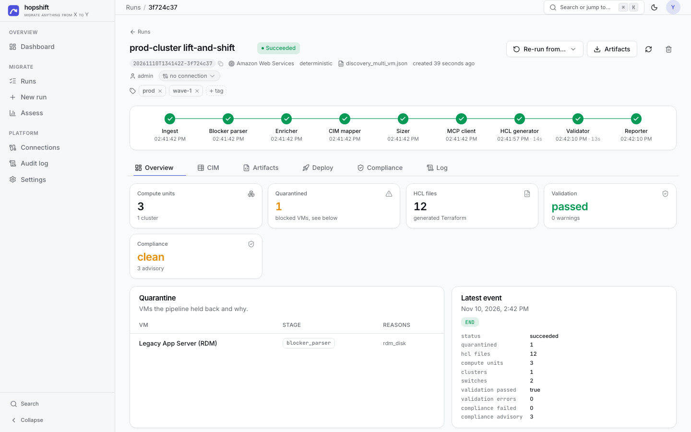
</p>

## Sources and targets

| | Name | Tier |
|---|---|---|
| Source | VMware vSphere (`vmware-discovery-stage1`) | tested |
| Target | AWS | tested |
| Target | Microsoft Azure | tested |
| Target | Google Cloud | tested |
| Target | OpenStack | validated |
| Target | Proxmox VE | in progress ([docs/targets/proxmox.md](docs/targets/proxmox.md)) |

`tested` means the integration suite renders the target on every change and runs real
`terraform validate`, `tflint` and the OPA bundle against the output; `validated` means the same
without a tflint ruleset. The definitions and the full matrix are in
[docs/support-matrix.md](docs/support-matrix.md). Adding a source or a target is a Python
package with an entry point: see [docs/plugins.md](docs/plugins.md).

## Security and compliance

The platform implements the technical controls auditors look for and produces evidence:

| Area | What you get |
|---|---|
| Access | Local accounts (argon2id), TOTP second factor with recovery codes, OIDC single sign-on, roles viewer / operator / admin, API tokens, lockout and throttling, session expiry |
| Audit | Hash-chained audit log of every action (actor, IP, agent, outcome), export, integrity verification |
| Secrets | Target credentials and MFA secrets encrypted at rest with a key that lives only in the environment; rotation; nothing secret in logs or responses |
| Transport and browser | Security headers, strict CSP, HSTS on TLS, same-origin checks for cookie-authenticated mutations |
| Output | OPA controls mapped to CIS Benchmarks (AWS, Azure, GCP), SOC 2 Trust Services Criteria and the HIPAA Security Rule; compliance report with every run |
| Change control | Pause points, typed confirmations for apply and destroy, plan/artifact integrity checks |
| Platform | Non-root, read-only container with capabilities dropped; posture page with live checks; retention policies |

SOC 2 and HIPAA are organisational attestations; no software is "certified" on its own. This
platform gives you the controls and the evidence. See [docs/security.md](docs/security.md) and
[docs/compliance.md](docs/compliance.md).

<p align="center">
  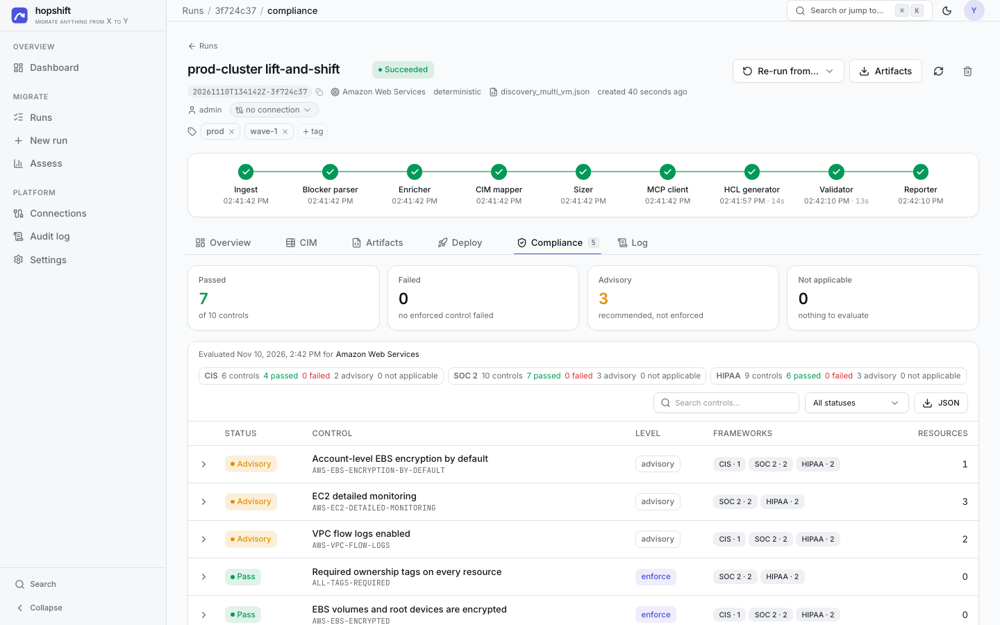
</p>

## Screenshots

| | |
|---|---|
| 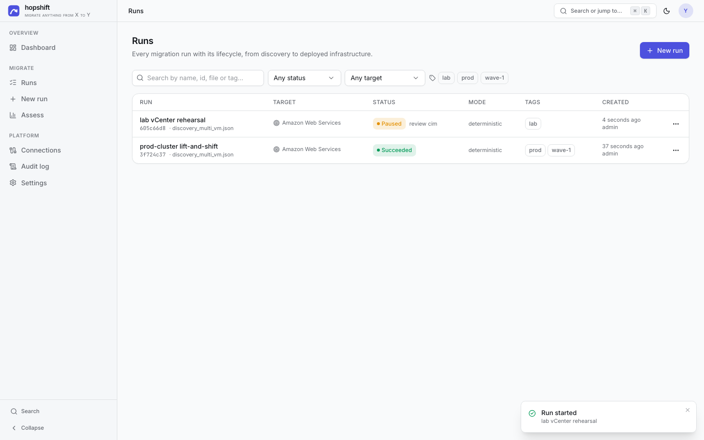 | 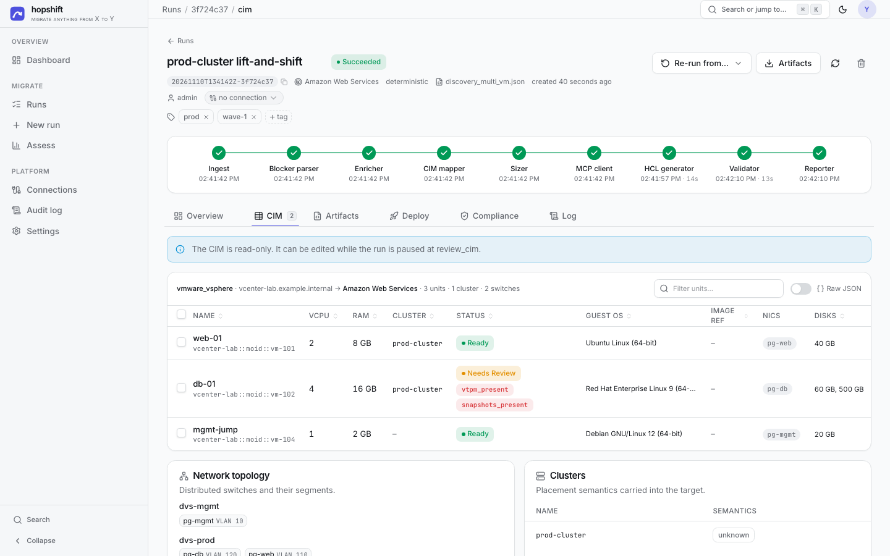 |
| 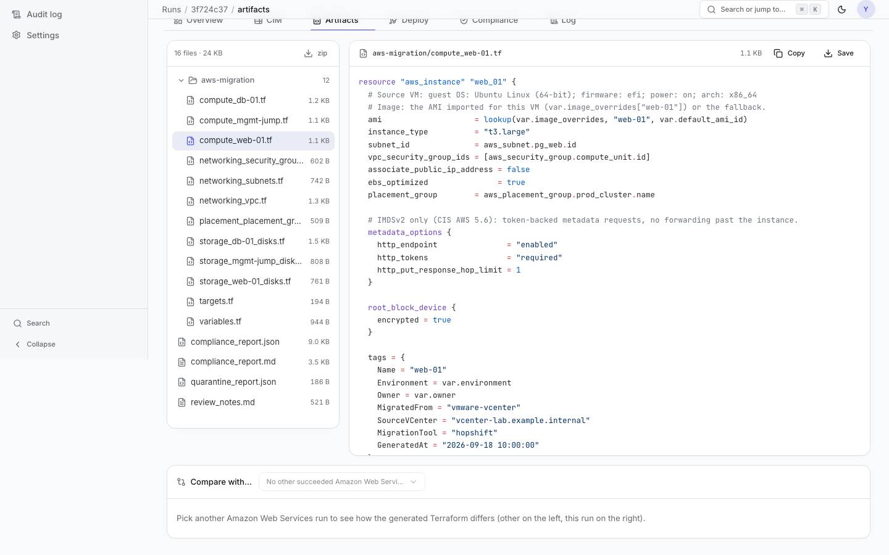 | 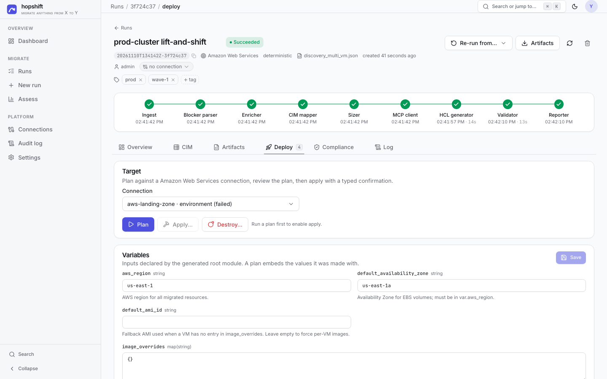 |
| 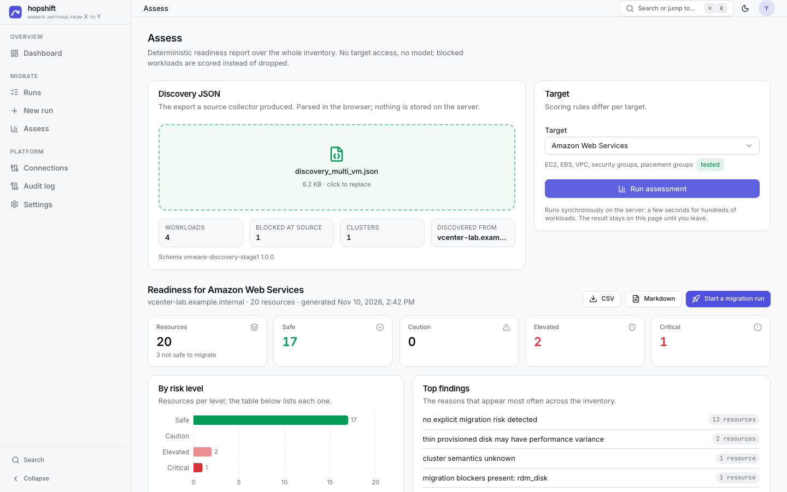 | 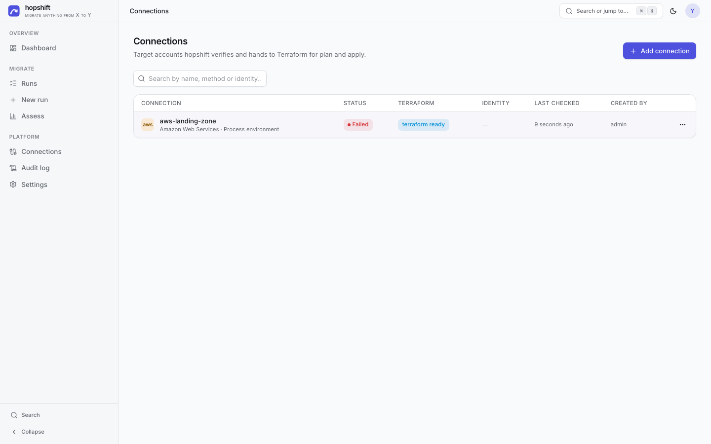 |
| 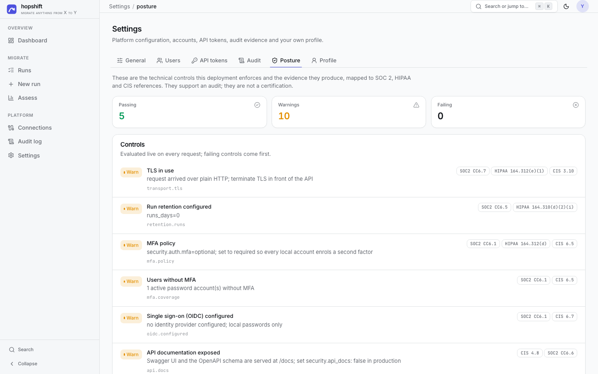 | 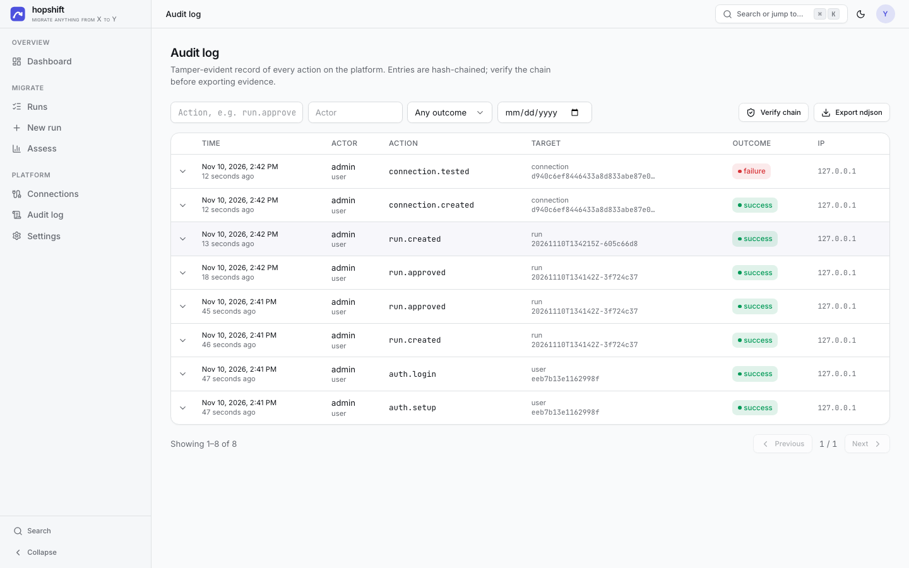 |

Dark mode is a click away:

<p align="center">
  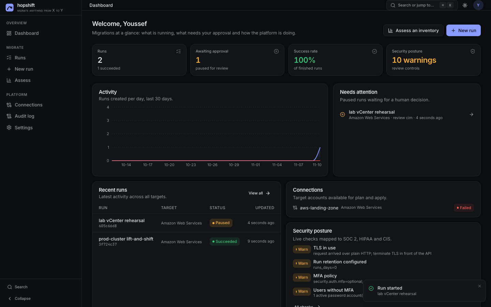
</p>

## Connections

Every sign-in method you are likely to meet, verified before use and resolved into the
environment Terraform expects:

| Target | Methods |
|---|---|
| AWS | access keys, named profile, assume role, environment (instance role / IRSA), IAM Identity Center (SSO device login), web identity; optional custom endpoint (LocalStack) |
| Azure | service principal (secret or certificate), managed identity, workload identity (OIDC), Azure CLI, device code |
| GCP | service account key, application default credentials, impersonation, workload identity federation |
| OpenStack | password, application credential, clouds.yaml |

See [docs/connections.md](docs/connections.md).

## Documentation

| | |
|---|---|
| [Architecture](docs/architecture.md) | Sources, the CIM, targets, the registries, the pipeline, platform services, API and UI |
| [Setup and operations](docs/setup.md) | Docker, local development, production checklist, backups |
| [Plugins](docs/plugins.md) | Writing a source or a target package and registering it |
| [Support matrix](docs/support-matrix.md) | Tiers, what each tier guarantees, evidence per source and target |
| [Sources](docs/sources/vmware.md) | VMware vSphere: schema, translation rules, blockers |
| [Targets](docs/targets/aws.md) | [AWS](docs/targets/aws.md) · [Azure](docs/targets/azure.md) · [GCP](docs/targets/gcp.md) · [OpenStack](docs/targets/openstack.md): what is rendered, variables, images, controls |
| [Security](docs/security.md) | Accounts, MFA, SSO, tokens, headers, retention, threat model |
| [Compliance](docs/compliance.md) | The control matrix and the report format |
| [Connections](docs/connections.md) | Providers, methods, fields, Terraform environment mapping |
| [Deployments](docs/deployments.md) | Plan, apply, destroy, state, LocalStack recipe |
| [HTTP API](docs/api.md) | Every endpoint with roles and bodies |
| [UI](docs/ui.md) | Pages, keyboard shortcuts, building and testing |
| [CLI](docs/cli.md) | `hopshift` commands |
| [Pipeline](docs/pipeline.md) · [CIM](docs/cim-and-translation.md) · [Discovery schema](docs/discovery-schema.md) · [Configuration](docs/configuration.md) · [AI usage](docs/ai-usage.md) | The core |

## Development

```bash
pip install -e ".[dev]" && pre-commit install && (cd ui && npm ci)
pytest -q --ignore=tests/integration --cov    # fast unit suite with coverage
pytest -q tests/integration                   # real terraform/tflint/opa on every built-in target
cd ui && npx vitest run --coverage && npm run build && npx playwright test
```

Pull requests get the full treatment automatically: lint, unit tests on three Python
targets, integration, UI, end-to-end, secret and dependency scans, semgrep, trivy, CodeQL, a
coverage comment and a dependency review. Releases build a signed multi-arch image on GHCR.
See [docs/ci.md](docs/ci.md), [CONTRIBUTING.md](CONTRIBUTING.md) and [SECURITY.md](SECURITY.md).

Prefer the published image? `docker pull ghcr.io/blacksoxx/hopshift:latest`
(linux/amd64 and linux/arm64, Sigstore-signed; see the release notes to verify).

## Roadmap

In priority order:

1. **Data movement**: disk export and image import per target (VM Import/Export, Azure
   managed images, GCE image import, Glance upload), replication and cutover runbooks with
   rollback, feeding `image_overrides` automatically.
2. **Dependency mapping**: discover relationships between workloads, networks and external
   services (flows, DNS, shared storage) before rendering, and group migrations into waves.
3. **Migration validation**: pre-flight checks on the source and post-apply checks on the target
   (boot, reachability, agent health), recorded with the run.
4. **Observability**: Prometheus metrics, OpenTelemetry traces for runs and deployments,
   structured failure diagnostics.
5. **State and environments from the UI**: remote state backends and workspaces managed per
   environment, with locking visible in the deployment view.
6. **More sources and targets through the plugin interface**: Proxmox VE (in progress),
   Hyper-V, Nutanix, IBM PowerVC; notifications (Slack, email).

## License

MIT. Built by [@blacksoxx](https://github.com/blacksoxx).
