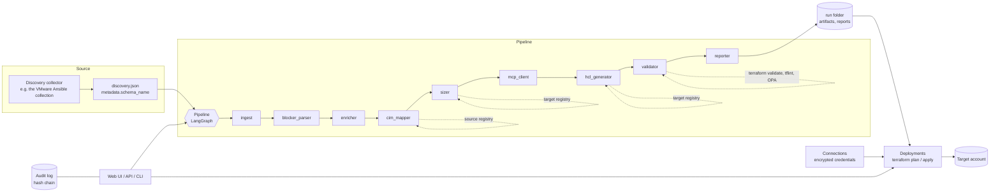
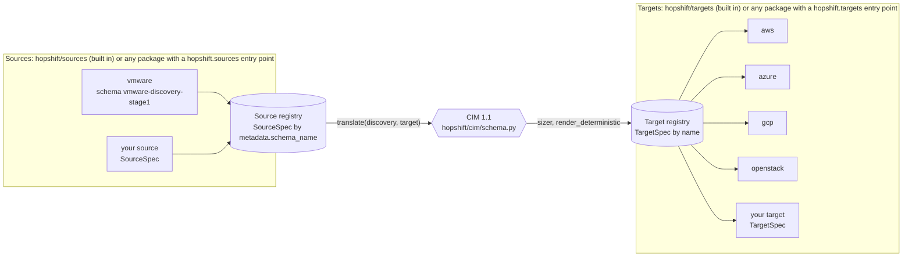
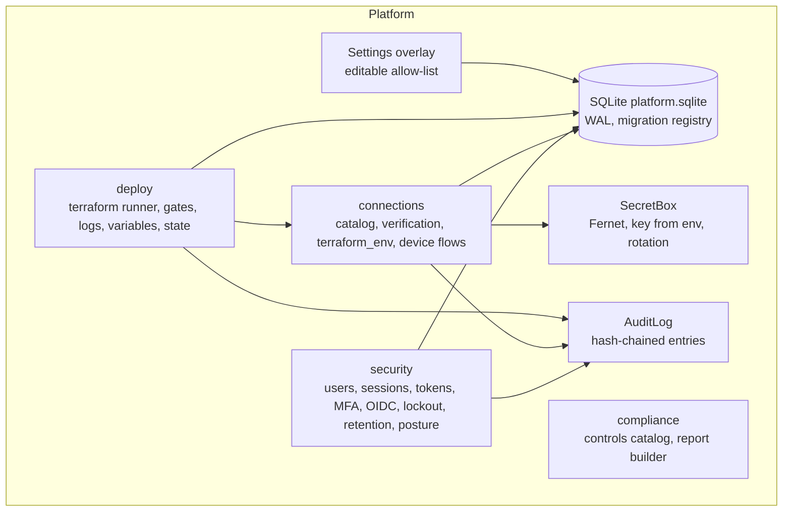

# Architecture

This document explains how hopshift is put together: the sources that produce a canonical
model, the targets that render it, the registries that bind them, the pipeline in between,
the platform services around it (accounts, audit, connections, deployments, compliance), the
web UI, and the storage layout. It is written for engineers who want to run, extend or audit
the system.

## 1. The big picture



Three ideas shape everything:

1. **One canonical model.** Every transformation goes through the Canonical Infrastructure
   Model (CIM). Sources produce it, targets consume it, neither knows about the other. Adding a
   source or a target is a package registered in a registry, not a change to the core.
2. **Deterministic core, AI at the edges.** The default path from discovery to Terraform is
   plain Python driven by data (the CIM, sizing tables, renderers). A model may write review
   notes or, in the optional `llm`/`hybrid` modes, propose Terraform. It never decides whether
   output is valid or compliant; terraform, tflint and OPA do.
3. **Humans approve.** Runs pause for CIM review and before anything is written; apply and
   destroy require a typed confirmation; every decision is in the audit log.

## 2. Repository layout

Everything lives in one package, `hopshift/`:

| Path | Responsibility |
|---|---|
| `hopshift/cim/` | The Canonical Infrastructure Model (`schema.py`, Pydantic v2, CIM 1.1), the blocker vocabulary (`blockers.py`), the JSON schema export (`schema_export.py`, `cim.schema.json`) |
| `hopshift/sources/` | The source registry (`registry.py`, `SourceSpec`) and the built-in VMware translator (`vmware.py`) |
| `hopshift/targets/` | The target registry (`registry.py`, `TargetSpec`), shared renderer helpers (`common.py`, `runtime_common.py`) and one package per built-in target (`aws/`, `azure/`, `gcp/`, `openstack/`, `proxmox/`) with `network`, `compute`, `storage`, `placement`, `runtime` and `sizing_table` modules |
| `hopshift/pipeline/` | The LangGraph graph (`graph.py`, `nodes/`), `MigrationState` (`state.py`), the run service layer (`runtime.py`), configuration loading, the LLM client and prompts, the deterministic assembler (`generation/deterministic.py`) |
| `hopshift/validation/` | terraform/tflint runner, OPA client, HCL parser, path policy, Rego policies (`policies/` for the gate, `policies/compliance/` for the control catalog) |
| `hopshift/services/` | Platform services: database, secrets, audit, settings, `security/`, `connections/`, `deploy/`, `compliance/`, the `Platform` container and `errors.py` |
| `hopshift/api/` | FastAPI app factory, middleware, dependencies (principal, roles), one router per area under `routes/` |
| `hopshift/cli/` | The `hopshift` command: `terragen`, `assess`, `serve`, `report`, `mcp-check`, `admin`, `secrets`, `audit`, `runs` |
| `ui/` | React 19 + Vite + Tailwind v4 web application (served by the API from `ui/dist`) |
| `tests/` | Mirrors the package: `api/`, `cim/`, `cli/`, `generation/`, `nodes/`, `pipeline/`, `services/`, `targets/`, `validation/`, `integration/` (real terraform/tflint/opa), `fixtures/` |
| `docs/` | This documentation |

## 3. Sources, the CIM and targets



### 3.1 The CIM

The CIM is the contract. It describes compute units (vCPU, RAM, guest OS, firmware, blockers,
NICs, volumes, optional `image_ref`), storage volumes, the network topology (virtual switches and
segments) and clusters with placement semantics. Attribute names keep neutral aliases so a
non-VMware source can use neutral vocabulary. The `target_provider` field is a lower-case target
name validated against the registry, not an enum, so a plugin target needs no change to the
model. See [cim-and-translation.md](cim-and-translation.md).

### 3.2 Sources and the source registry

A source is identified by the `metadata.schema_name` values its discovery payloads carry and
provides one function, `translate(discovery: dict, target: str) -> CanonicalInfrastructureModel`.
`hopshift/sources/registry.py` holds a `SourceSpec` per source (name, label, schema names,
translator, platform, tier, collector, docs). Built-in sources register in
`hopshift/sources/__init__.py`; third-party packages register through the `hopshift.sources`
entry-point group. `cim_mapper` resolves the translator with `registry.for_schema()` and fails
with the list of known schemas when none matches.

The blocker vocabulary (`hopshift/cim/blockers.py`) is keyed by source platform so a source can
map its own flags to the canonical hard and soft blockers. The built-in source is documented in
[sources/vmware.md](sources/vmware.md).

### 3.3 Targets and the target registry

A target is a Python package that exposes the renderer modules the deterministic assembler
calls (`network`, `compute`, `storage`, `placement`, `runtime`) and a `sizing_table` with
`get_instance_type(vcpus, ram_mb)`. `hopshift/targets/registry.py` holds a `TargetSpec` per
target: name, label, blurb, package, tier (`tested`, `validated`, `experimental`), whether tflint
has a ruleset for it, the connections catalog key used for deployments, the guest architectures
it can host, and its docs path. Built-in targets register in `hopshift/targets/__init__.py`;
third-party packages register through the `hopshift.targets` entry-point group. A plugin that
fails to import is logged and skipped so it cannot take the platform down.

Everything that needs a target reads the registry: the CLI `--cloud` choices, `RunOptions`
validation in the runtime, the sizer (sizing table), the deterministic assembler (renderer
modules and the `<name>-migration/` root), the validator (tflint on or off per target) and
`GET /api/meta` (`targets` and `sources` lists for the UI). The built-in targets are documented
under [targets/](targets/aws.md).

### 3.4 What a plugin gets, and what stays in the core today

The plugin contract is described in [plugins.md](plugins.md) and the tiers in
[support-matrix.md](support-matrix.md). The boundaries as the code stands:

- The deterministic path (`generation.mode: deterministic`, the default) is fully registry
  driven. A target package only needs the six modules above.
- The `llm` and `hybrid` modes keep built-in knowledge in `hopshift/pipeline/nodes/hcl_generator.py`:
  the provider source allow-list is a map of the four built-in targets (plus `hashicorp/random`,
  `hashicorp/tls`, `hashicorp/time` for all), and the AWS module synthesis and the GCP and
  OpenStack normalisation steps are specific to those targets. A plugin target works in
  deterministic mode first.
- The gate policies and the compliance catalog (`hopshift/validation/policies/`,
  `hopshift/services/compliance/controls.py`) know the built-in resource types. A plugin target
  gets the generic rules (no code execution, path policy) and no target-specific controls until
  rules and catalog entries are added.
- Deployments need a connections catalog entry (`hopshift/services/connections/models.py`);
  `TargetSpec.connection_provider` is `None` for a target without one, and such runs cannot be
  deployed from the platform.

### 3.5 Secure by default output

Renderers emit hardened resources so the compliance policies pass without manual edits:
IMDSv2 and no public IPs on AWS instances, encrypted volumes, locked-down default security
groups, OS Login, shielded VMs, limited service-account scopes, subnet flow logs on GCP, no
public IPs on Azure NICs, no management ports open to the Internet anywhere. Environment, Owner
and MigratedFrom tags are on every taggable resource. See [compliance.md](compliance.md).

## 4. The pipeline

The graph is a straight line with two optional pause points. The reporter always runs so
every run leaves a quarantine report, review notes and a compliance report behind, but
Terraform is written only when validation passed.

| Node | What it does | Deterministic? |
|---|---|---|
| `ingest` | Checks the discovery payload against the minimum contract (object root, `virtual_machines` list of objects), warns on schema drift and missing sizing data, loads it into state | yes |
| `blocker_parser` | Applies the hard blockers (encrypted VM, RDM or shared disks, templates, unsupported architecture) and soft blockers (vTPM, mounted ISO, snapshots, powered off, vApp) from `hopshift/cim/blockers.py`. Hard-blocked workloads go to the quarantine queue | yes |
| `enricher` | Normalises names, guest OS families, derives per-workload facts the translator needs | yes |
| `cim_mapper` | Runs the translator registered for the discovery `schema_name` and produces the CIM | yes |
| `sizer` | Maps vCPU/RAM to instance types with the target's sizing table; produces `sized_cim` | yes |
| `mcp_client` | Optional: retrieves Terraform Registry documentation through the MCP server for `llm`/`hybrid` generation | n/a |
| `hcl_generator` | `deterministic`: renders the target package from the CIM. `llm`/`hybrid`: the model writes files inside a validation loop. Security guards reject provisioners, external data sources, non-local modules and unknown provider sources | by default |
| `validator` | The gate: terraform init + validate, tflint (skipped for targets without a ruleset unless forced), OPA (gate and compliance policies). Writes `validation_result` and `compliance_result` | yes |
| `reporter` | Writes artifacts: the Terraform root module (if valid), `quarantine_report.json`, `review_notes.md` (deterministic text or model-written), `compliance_report.{json,md}` | yes, notes optional |

Pause points are named so clients never need node names: `review_cim` pauses before
`hcl_generator` (edit the CIM, then approve) and `approve_output` pauses before `reporter`
(nothing is written until approved). Runs can be cancelled between nodes and re-run from any
checkpoint. See [pipeline.md](pipeline.md) and [runtime-and-api.md](runtime-and-api.md).

## 5. Platform services (`hopshift/services/`)



- **Database.** One SQLite file with WAL. Each service registers its own schema at import time
  (`register_migration`); `Platform.from_config` applies pending migrations once.
- **Secrets.** `HOPSHIFT_SECRET_KEY` holds one or more Fernet keys; the first encrypts, all decrypt.
  Rotation re-encrypts every stored secret with the primary key. Without a key the platform runs
  but refuses to store credentials.
- **Audit log.** Every entry carries the hash of the previous one; `verify` recomputes the chain.
  Retention pruning re-anchors the chain and records itself.
- **Settings.** A small allow-list of configuration keys can be changed from the UI by an admin;
  the overlay is applied over `config.yaml` at run creation. Everything else is file-only.
- **Security.** Local accounts (argon2id), sessions (HttpOnly, SameSite=Lax, Secure on TLS,
  absolute and idle expiry), API tokens (stored hashed, scoped by role), roles viewer / operator /
  admin, TOTP second factor with recovery codes (optional or required), OIDC single sign-on with
  PKCE and group-to-role mapping, login lockout and per-IP throttling, security headers and CSP,
  origin checks for cookie-authenticated mutations, retention sweeps, posture checks. See
  [security.md](security.md).
- **Connections.** A catalog describes every provider and sign-in method with its fields so
  the UI renders forms generically. Verification calls the target (STS, ARM, Resource Manager,
  Keystone) and records the identity. At deployment time credentials are resolved into the
  environment variables Terraform providers read. See [connections.md](connections.md).
- **Deployments.** Terraform runs in a fresh copy of the run's root module with state kept
  outside the artifacts, streaming logs with secret masking, timeouts and cancellation. Plan is
  always allowed; apply needs a succeeded plan whose artifacts have not changed and a typed
  confirmation; destroy needs the same confirmation. See [deployments.md](deployments.md).
- **Compliance.** OPA policies emit violations tagged with a control id and level; the report
  builder maps them to the catalog (CIS Benchmark, SOC 2 TSC, HIPAA Security Rule references)
  and writes the report with the artifacts. See [compliance.md](compliance.md).

## 6. The API (`hopshift/api/`)

FastAPI, all routes under `/api`, one router per area. `hopshift/api/deps.py` resolves the
principal from a session cookie or bearer token and enforces roles; `hopshift/api/middleware.py`
adds security headers and the origin check. Long-running work (runs, deployments) executes in
thread pools and is observed through polling or server-sent events. The built UI is served
from `/`.

Errors: services raise `hopshift.services.errors` exceptions which the app maps to
400/403/404/409/503; authentication failures are 401. See [api.md](api.md) for the endpoint list.

## 7. The UI (`ui/`)

React 19 with Vite, TypeScript, Tailwind v4, Radix primitives and `motion`. No UI framework:
the components under `ui/src/components/ui` are owned by the repository. Pages: setup and login,
dashboard, runs, new-run wizard, run detail (timeline, overview, CIM editor, artifacts with diff,
deployments, compliance, log), assess, connections, settings (general, users, tokens, audit,
posture, profile). The UI only talks to `/api`; it has no secrets and no business logic beyond
presentation. See [ui.md](ui.md).

## 8. Storage layout

```
output/
  platform.sqlite                 users, sessions, tokens, connections, deployments, audit_log, settings
  runs/
    checkpoints.sqlite            LangGraph checkpoints (pause / resume / re-run)
    <run_id>/
      run.json                    lifecycle record (name, tags, status, options, connection)
      discovery.json[.enc]        input payload (encrypted when security.encrypt_run_inputs is on)
      config.json                 the effective configuration of this run
      events.jsonl                one event per node, pause, patch, resume, rerun, cancel, error, end
      artifacts/
        <target>-migration/*.tf   the generated root module (only when validation passed)
        quarantine_report.json
        review_notes.md
        compliance_report.json / compliance_report.md
      deploy/
        workspace/                fresh copy of the root module per deployment
        state/terraform.tfstate   local state (unless deploy.remote_state is configured)
        terraform.tfvars.json
        <deployment_id>/          deployment.json, terraform.log, tfplan, plan.json
```

Back up `output/` to keep everything; `platform.sqlite` is the only file holding credentials and
they are encrypted with `HOPSHIFT_SECRET_KEY`, which must be backed up separately.

## 9. Trust boundaries and threat model

- **Operators and viewers** authenticate to the API; roles limit what they can do; all actions
  are audited with actor, IP and user agent.
- **The discovery file** is untrusted input: it is checked against the contract, workload names
  are sanitised before they become file names or resource identifiers, string values are escaped
  so they cannot open a Terraform template expression, and generated paths are checked for
  traversal.
- **Generated Terraform** is treated as code: no provisioners, no external/http data sources,
  no `null_resource` or `local_file`, only local module sources and allow-listed provider
  sources. It is validated before it is written and scanned by policy before it is deployed.
- **Target credentials** never leave the server, are stored only encrypted, are redacted from
  logs and API responses, and reach Terraform only as process environment of the deployment.
- **The model** (when used) receives the CIM and documentation, never credentials, and its
  output goes through the same gate as deterministic output.
- **Plugins** are Python code loaded into the process; install only packages you trust, as you
  would any dependency.
- **The container** runs as a non-root user on a read-only root filesystem with all
  capabilities dropped (see `docker-compose.yml`).

## 10. Extending

- New target: a package with `network`, `compute`, `storage`, `placement`, `runtime` and
  `sizing_table` modules plus a `TargetSpec` (built in: register it in
  `hopshift/targets/__init__.py`; external: a `hopshift.targets` entry point). Then, for
  deployments and compliance, catalog entries in `hopshift/services/connections/models.py`,
  Rego rules and `Control` entries, and an integration test case. See [plugins.md](plugins.md).
- New source: a translator producing the CIM plus a `SourceSpec` keyed by the collector's
  `metadata.schema_name` (built in: `hopshift/sources/__init__.py`; external: a
  `hopshift.sources` entry point), blockers in `hopshift/cim/blockers.py` if its flags differ, a
  fixture and a translator test. See [plugins.md](plugins.md).
- New compliance control: Rego rule plus catalog entry with framework references and a test.
  See [compliance.md](compliance.md).
- New API area: `hopshift/services/<area>/` service with `build_<area>_service(platform)` and a
  router in `hopshift/api/routes/`; it is discovered automatically.
