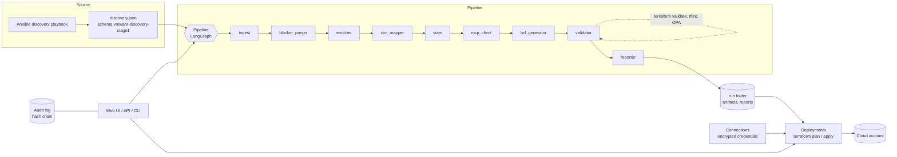
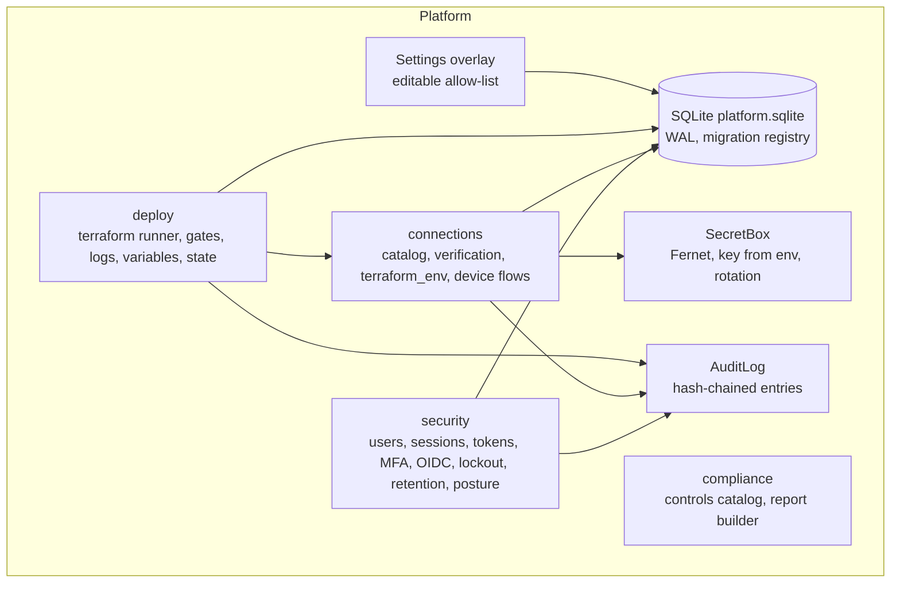

# Architecture

This document explains how the platform is put together: the pipeline that turns a vSphere
discovery file into Terraform, the platform services around it (accounts, audit, cloud
connections, deployments, compliance), the web UI, and the storage layout. It is written for
engineers who want to run, extend or audit the system.

## 1. The big picture



Three ideas shape everything:

1. **Deterministic core.** Every transformation from discovery to Terraform is plain Python
   driven by data (the CIM, sizing tables, templates). The same input always yields the same
   output, which makes diffs, reviews and tests meaningful.
2. **AI at the edges, never in the gate.** A model may write review notes or, in the optional
   `llm`/`hybrid` modes, propose Terraform. It never decides whether output is valid or
   compliant; terraform, tflint and OPA do.
3. **Humans approve.** Runs pause for CIM review and before anything is written; apply and
   destroy require a typed confirmation; every decision is in the audit log.

## 2. Repository layout

| Path | Responsibility |
|---|---|
| `agent/` | LangGraph pipeline (`graph.py`, `nodes/`), run service layer (`runtime.py`), LLM client, deterministic assembler (`generation/`) |
| `cim/` | Canonical Infrastructure Model (Pydantic), source translators (`translators/`), blocker registry, JSON schema export |
| `providers/` | One package per target cloud: compute, network, storage, placement, runtime (providers.tf/variables.tf), sizing table |
| `validation/` | terraform/tflint runner, OPA client, HCL parser, path policy, Rego policies (`policies/` and `policies/compliance/`) |
| `vma/` | Platform services: database, secrets, audit, settings, `security/`, `connections/`, `deploy/`, `compliance/` |
| `api/` | FastAPI app factory, middleware, dependencies (principal, roles), one router per area under `routes/` |
| `cli/` | The `vma` command: `terragen`, `assess`, `serve`, `report`, `mcp-check`, `admin`, `secrets`, `audit`, `runs` |
| `ui/` | React 19 + Vite + Tailwind v4 web application (served by the API from `ui/dist`) |
| `tests/` | Unit tests per area, `integration/` with real terraform/tflint/opa, fixtures |
| `docs/` | This documentation |

## 3. The pipeline

The graph is a straight line with two optional pause points. The reporter always runs so
every run leaves a quarantine report, review notes and a compliance report behind, but HCL is
written only when validation passed.

| Node | What it does | Deterministic? |
|---|---|---|
| `ingest` | Validates the discovery payload against the expected schema and loads it into state | yes |
| `blocker_parser` | Applies the platform's hard blockers (encrypted VM, RDM or shared disks, templates, unsupported architecture) and soft blockers (vTPM, mounted ISO, snapshots, powered off, vApp). Hard-blocked VMs go to the quarantine queue | yes |
| `enricher` | Normalises names, guest OS families, derives per-VM facts the translator needs | yes |
| `cim_mapper` | Runs the translator registered for the discovery `schema_name` and produces the CIM (compute units, storage volumes, network topology, clusters) | yes |
| `sizer` | Maps vCPU/RAM to instance types with per-cloud sizing tables; produces `sized_cim` | yes |
| `mcp_client` | Optional: retrieves Terraform Registry documentation through the MCP server for `llm`/`hybrid` generation | n/a |
| `hcl_generator` | `deterministic`: renders the provider templates from the CIM. `llm`/`hybrid`: the model writes files inside a validation loop. Security guards reject provisioners, external data sources, non-local modules and unknown provider sources | by default |
| `validator` | The gate: terraform init + validate, tflint, OPA (security and compliance policies). Writes `validation_result` and `compliance_result` | yes |
| `reporter` | Writes artifacts: Terraform root module (if valid), `quarantine_report.json`, `review_notes.md` (deterministic text or model-written), `compliance_report.{json,md}` | yes, notes optional |

Pause points are named so clients never need node names: `review_cim` pauses before
`hcl_generator` (edit the CIM, then approve) and `approve_output` pauses before `reporter`
(nothing is written until approved). Runs can be cancelled between nodes and re-run from any
checkpoint.

### 3.1 The CIM

The Canonical Infrastructure Model is the contract between the source world and the cloud
world. Translators (one per source hypervisor, selected by `metadata.schema_name`) produce it;
providers consume it. Adding a hypervisor means adding a translator; adding a cloud means
adding a provider package. Neither side knows about the other. See
[cim-and-translation.md](cim-and-translation.md).

### 3.2 Secure by default output

Renderers emit hardened resources so the compliance policies pass without manual edits:
IMDSv2 and no public IPs on AWS instances, encrypted volumes, locked-down default security
groups, OS Login, shielded VMs, limited service-account scopes, subnet flow logs on GCP, TLS-only
storage on Azure, no management ports open to the Internet anywhere. Environment, Owner and
MigratedFrom tags are on every taggable resource. See [compliance.md](compliance.md).

## 4. Platform services (`vma/`)



- **Database.** One SQLite file with WAL. Each service registers its own schema at import time
  (`register_migration`); `Platform.from_config` applies pending migrations once.
- **Secrets.** `VMA_SECRET_KEY` holds one or more Fernet keys; the first encrypts, all decrypt.
  Rotation re-encrypts every stored secret with the primary key. Without a key the platform runs
  but refuses to store credentials.
- **Audit log.** Every entry carries the hash of the previous one; `verify` recomputes the chain.
  Retention pruning re-anchors the chain and records itself.
- **Settings.** A small allow-list of configuration keys can be changed from the UI by an admin;
  the overlay is applied over `config.yaml` at run creation. Everything else is file-only.
- **Security.** Local accounts (argon2id), sessions (HttpOnly, SameSite=Lax, Secure on TLS,
  absolute and idle expiry), API tokens (stored hashed, scoped by role), roles viewer / operator /
  admin, TOTP second factor with recovery codes (optional or required), OIDC single sign-on with
  PKCE and group-to-role mapping, login lockout and per-IP throttling, security headers and CSP,
  origin checks for cookie-authenticated mutations, retention sweeps, posture checks. See
  [security.md](security.md).
- **Connections.** A catalog describes every provider and sign-in method with its fields so
  the UI renders forms generically. Verification calls the cloud (STS, ARM, Resource Manager,
  Keystone) and records the identity. At deployment time credentials are resolved into the
  environment variables Terraform providers read. See [connections.md](connections.md).
- **Deployments.** Terraform runs in a fresh copy of the run's root module with state kept
  outside the artifacts, streaming logs with secret masking, timeouts and cancellation. Plan is
  always allowed; apply needs a succeeded plan whose artifacts have not changed and a typed
  confirmation; destroy needs the same confirmation. See [deployments.md](deployments.md).
- **Compliance.** OPA policies emit violations tagged with a control id and level; the report
  builder maps them to the catalog (CIS Benchmark, SOC 2 TSC, HIPAA Security Rule references)
  and writes the report with the artifacts. See [compliance.md](compliance.md).

## 5. The API (`api/`)

FastAPI, all routes under `/api`, one router per area. `api/deps.py` resolves the principal
from a session cookie or bearer token and enforces roles; `api/middleware.py` adds security
headers and the origin check. Long-running work (runs, deployments) executes in thread pools
and is observed through polling or server-sent events. The built UI is served from `/`.

Errors: services raise `vma.errors` exceptions which the app maps to 400/403/404/409/503;
authentication failures are 401. See [api.md](api.md) for the endpoint list.

## 6. The UI (`ui/`)

React 19 with Vite, TypeScript, Tailwind v4, Radix primitives and `motion`. No UI framework:
the components under `ui/src/components/ui` are owned by the repository. Pages: setup and login,
dashboard, runs, new-run wizard, run detail (timeline, overview, CIM editor, artifacts with diff,
deployments, compliance, log), assess, connections, settings (general, users, tokens, audit,
posture, profile). The UI only talks to `/api`; it has no secrets and no business logic beyond
presentation. See [ui.md](ui.md).

## 7. Storage layout

```
output/
  platform.sqlite                 users, sessions, tokens, connections, deployments, audit_log, settings
  runs/
    checkpoints.sqlite            LangGraph checkpoints (pause / resume / re-run)
    <run_id>/
      run.json                    lifecycle record (name, tags, status, options, connection)
      discovery.json[.enc]        input payload (encrypted when security.encrypt_run_inputs is on)
      config.json                 the effective configuration of this run
      events.jsonl                one event per node, pause, patch, resume, rerun, cancel, error, end
      artifacts/
        <cloud>-migration/*.tf    the generated root module (only when validation passed)
        quarantine_report.json
        review_notes.md
        compliance_report.json / compliance_report.md
      deploy/
        workspace/                fresh copy of the root module per deployment
        state/terraform.tfstate   local state (unless deploy.remote_state is configured)
        terraform.tfvars.json
        <deployment_id>/          deployment.json, terraform.log, tfplan, plan.json
```

Back up `output/` to keep everything; `platform.sqlite` is the only file holding credentials and
they are encrypted with `VMA_SECRET_KEY`, which must be backed up separately.

## 8. Trust boundaries and threat model

- **Operators and viewers** authenticate to the API; roles limit what they can do; all actions
  are audited with actor, IP and user agent.
- **The discovery file** is untrusted input: it is validated against the schema, VM names are
  sanitised before they become file names, and generated paths are checked for traversal.
- **Generated Terraform** is treated as code: no provisioners, no external/http data sources,
  no `null_resource` or `local_file`, only local module sources and allow-listed provider
  sources. It is validated before it is written and scanned by policy before it is deployed.
- **Cloud credentials** never leave the server, are stored only encrypted, are redacted from
  logs and API responses, and reach Terraform only as process environment of the deployment.
- **The model** (when used) receives the CIM and documentation, never credentials, and its
  output goes through the same gate as deterministic output.
- **The container** runs as a non-root user on a read-only root filesystem with all
  capabilities dropped (see `docker-compose.yml`).

## 9. Extending

- New cloud: `providers/<name>/`, sizing table, compliance controls, connection catalog
  entries, integration test case.
- New source hypervisor: translator under `cim/translators/`, blockers in `cim/blockers.py`.
- New compliance control: Rego rule plus catalog entry with framework references and a test.
- New API area: `vma/<area>/` service with `build_<area>_service(platform)` and a router in
  `api/routes/`; it is discovered automatically.
