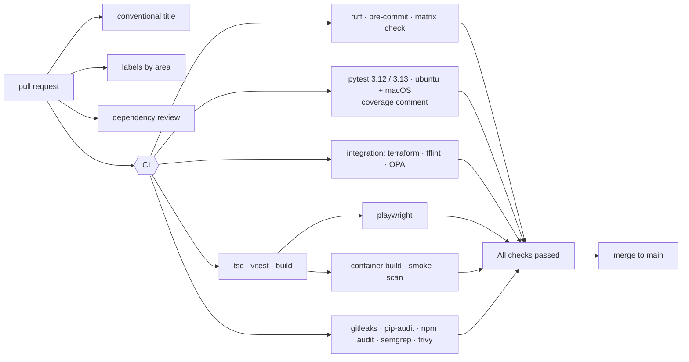

# Continuous integration and automation

Every change goes through the same gates, whether it comes from a maintainer or a first-time
contributor. All of it runs on GitHub Actions with free tooling; nothing needs an external
account.

## Pull request flow



`All checks passed` is the single required status check on `main`, so adding or renaming a
job never breaks branch protection.

## What each check does

| Check | Tool | Blocks the merge? |
|---|---|---|
| Lint | ruff, pre-commit hooks (yaml/json validity, large files, private keys), `hopshift matrix check` (support.yaml valid, `docs/support-matrix.md` regenerated) | yes |
| Python unit tests | pytest with coverage on Python 3.12 and 3.13 (Ubuntu) and 3.12 (macOS); a coverage comment is posted on the pull request and the badge updates on `main` | yes |
| Integration | real `terraform validate`, `tflint` and OPA on the rendered output for every built-in target; zero enforced compliance violations | yes |
| UI | TypeScript strict type-check, Vitest with coverage, production build | yes |
| End-to-end | Playwright against an isolated server: setup, sign-in, wizard, CIM edit, approvals, artifacts, compliance, connections, assess | yes |
| Security | gitleaks (secret scan of the whole history), pip-audit and npm audit (advisories), semgrep (`p/python`, `p/typescript`, `p/secrets` at error severity), trivy filesystem scan (lockfiles, Dockerfile and compose misconfiguration, secrets) | gitleaks, npm audit, semgrep and trivy yes; pip-audit reports |
| Container | image build with cache, smoke test (CLI, terraform, opa, non-root), boot of the image until `/api/health` answers, trivy image scan for fixed critical CVEs | build, smoke and boot yes; scan reports |
| CodeQL | security-and-quality queries for Python and JavaScript/TypeScript | reports to the Security tab |
| Conventional title | `type(scope): summary` with a lowercase subject | yes |
| Dependency review | new dependencies with high-severity advisories or GPL/AGPL/SSPL licences | yes |
| Labels | path-based `area:` labels | no |

## Bots and scheduled jobs

- **Dependabot** opens grouped weekly updates for pip and npm and monthly updates for GitHub
  Actions and the Docker base image. Alerts are enabled for the repository.
- **OpenSSF Scorecard** runs weekly and on every push to `main`; the badge in the README links to
  the public report.
- **Coverage comment** posts the Python coverage delta on pull requests, including those from
  forks (through a follow-up workflow with the needed permissions).
- **First interaction** greets first-time issue and pull request authors.
- **Stale** marks issues and pull requests after 60 days without activity and closes them 14 days
  later unless they are labelled `pinned`, `security` or `roadmap`.
- **Release** builds the multi-architecture image on every `v*` tag, pushes it to GHCR, signs it
  with Sigstore (keyless), attaches an SPDX SBOM and publishes the release notes.

## Running the same checks locally

```bash
pip install --require-hashes -r requirements/dev.txt && pip install --no-deps -e . && pre-commit install
ruff check . && pre-commit run --all-files && hopshift matrix check
pytest -q --ignore=tests/integration --cov
pytest -q tests/integration
cd ui && npx tsc --noEmit && npx vitest run --coverage && npm run build && npx playwright test
semgrep scan --config p/python --config p/typescript --config p/secrets --severity ERROR
docker run --rm -v "$PWD":/repo aquasec/trivy fs --scanners vuln,misconfig,secret --severity CRITICAL,HIGH /repo
```

## Release checklist

1. Update `version` in `pyproject.toml` and `hopshift/__init__.py`.
2. `git tag -a vX.Y.Z -m "..." && git push origin vX.Y.Z`.
3. The Release workflow builds and signs `ghcr.io/blacksoxx/hopshift:X.Y.Z` and
   publishes the release with generated notes and the SBOM.
4. Verify the signature:
   `cosign verify ghcr.io/blacksoxx/hopshift:X.Y.Z --certificate-identity-regexp 'https://github.com/blacksoxx/hopshift/' --certificate-oidc-issuer https://token.actions.githubusercontent.com`
